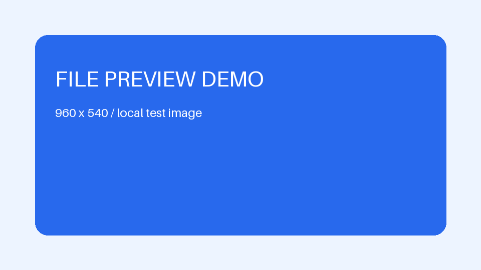

# 安全清理测试

本文件含有用于验证清理规则的 HTML。阅读模式下，下面的脚本和事件处理器均不应执行。可切换源码查看原始内容。

## 脚本标签

下面的脚本只设置一个测试标记，不访问网络、不读取存储、不操作文件。安全清理后不应执行：

## 图片事件

图片是正常的本地图片，事件属性应被移除，图片仍可显示：

## 危险协议链接

[此链接应失去跳转能力](javascript:window.__dataStationLinkTest=true)

## 嵌入页面与样式

下列内嵌页面、样式标签应被移除：

<iframe srcdoc="
这段嵌入页面不应显示
"></iframe>

## 正常内容

**这一段必须正常显示。** 安全清理只影响预览，不修改原文件。

| 检查项 | 预期 |
| --- | --- |
| window.__dataStationSecurityTest | 未定义 |
| window.__dataStationImageEvent | 未定义 |
| window.__dataStationLinkTest | 未定义 |
| 页面背景 | 保持正常 |
